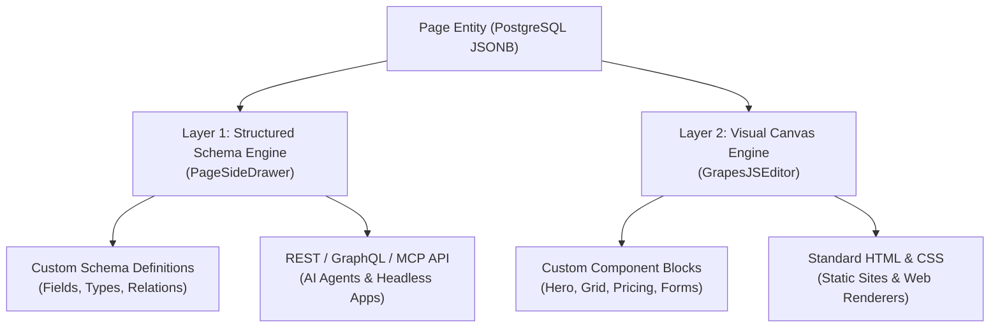

# ADR-0002: Dual-Builder Architecture: Structured Schemas & Visual Canvas

## Status

**Accepted** (Date: 2026-09-02)

## Context

A classic tension exists in modern Content Management Systems:

1. **The Headless Dilemma**: Traditional headless CMS platforms (Strapi, Sanity, Contentful) excel at structured, relational data modeling (typed fields, taxonomy, clean JSON). Developers, mobile apps, and AI agents thrive on this format. However, marketing and editorial teams often find pure form-based content authoring rigid, as they lack control over visual composition, responsive spacing, and dynamic page layouts.
2. **The Monolithic Dilemma**: Traditional page builders (WordPress with Elementor, Webflow, Squarespace) excel at visual layout freedom. However, they tangle presentation markup (HTML, inline CSS, classes) directly with the raw content data. This makes multi-channel distribution, mobile rendering, and automated AI consumption (e.g., via Model Context Protocol / MCP) virtually impossible without brittle HTML scraping.

We required an architectural model that delivers **first-class structured data for AI agents and API consumers** while simultaneously offering **drag-and-drop visual layout autonomy for human marketing teams**.

---

## Decision

We designed and implemented a **Dual-Builder Architecture** consisting of two complementary, synchronized editing surfaces operating on a unified content entity:



### Layer 1: Structured Schema Engine ([PageSideDrawer.tsx](file:///home/sobhan-sahoo/code/agentic-headless-cms/apps/cms-ui/src/components/PageSideDrawer/PageSideDrawer.tsx))

- **Role**: Headless Data Modeling & Metadata Governance.
- **Capabilities**:
  - Defines dynamic schemas with typed fields (`text`, `number`, `boolean`, `richtext`, `select`, `media`, `relation`).
  - Isolates field values into typed JSON (`PageCustomSchema.values`).
  - Manages global page metadata: Title, Canonical URL Slug, SEO description, and publication state (`draft` vs `published`).
- **Target Audience**: Human content editors, schema architects, and autonomous AI agents communicating over the Agent API / Model Context Protocol (MCP).

### Layer 2: Visual Canvas Engine ([GrapesJSEditor.tsx](file:///home/sobhan-sahoo/code/agentic-headless-cms/apps/cms-ui/src/features/collections/pages/editors/GrapesJSEditor.tsx))

- **Role**: Presentation Assembly & Visual Layout.
- **Capabilities**:
  - Drag-and-drop assembly using pre-designed modular CMS blocks ([CustomBlocksPlugin.ts](file:///home/sobhan-sahoo/code/agentic-headless-cms/apps/cms-ui/src/features/collections/pages/editors/components/CustomBlocksPlugin.ts)).
  - Responsive breakpoint simulation (Desktop, Tablet, Mobile).
  - Component settings panel allowing live editing of block properties (headings, buttons, colors, alignment).
- **Target Audience**: Marketers, landing page designers, and visual editors.

---

## Data Model & Storage

Content entries in the `content_pages` table persist data in unified PostgreSQL JSONB structures:

```typescript
export interface PageEntryData {
  title: string;
  slug: string;
  description?: string;
  // Layer 1: Attached custom schemas and their structured values
  _schemas: PageCustomSchema[];
  // Layer 2: Visual builder block tree and serialized canvas markup
  _canvas?: {
    html: string;
    css: string;
    components: unknown[];
  };
  [key: string]: unknown;
}
```

### Synchronization & Auto-Save Pipeline

1. **Separation of Concerns**: Changes to visual layout components do not overwrite or mutate Layer 1 schema values, and vice versa.
2. **Local Buffer & Crash Recovery**: Visual canvas changes are debounced (2000 ms) and saved to browser storage ([useCanvasAutoSave.ts](file:///home/sobhan-sahoo/code/agentic-headless-cms/apps/cms-ui/src/features/collections/hooks/useCanvasAutoSave.ts)).
3. **Draft Conflict Reconciliation**: If a user navigates back to a page with unsaved local changes, [DraftRecoveryBanner.tsx](file:///home/sobhan-sahoo/code/agentic-headless-cms/apps/cms-ui/src/features/collections/pages/editors/components/DraftRecoveryBanner.tsx) prompts to restore or discard the cached revision.

---

## Consequences

### Positive

- **No Compromise**: API-first consumers get clean, predictable JSON; marketing teams get a visual landing page builder.
- **AI Agent Friendly**: AI agents can inspect schemas, create pages, and update field values via MCP without having to understand or parse visual HTML layout trees.
- **Omnichannel Delivery**: The same page record can drive a Next.js landing page (using canvas HTML/CSS) and a mobile app or smartwatch widget (using structured `_schemas` JSON).

### Trade-offs & Mitigations

- **Storage Size**: JSONB records contain both structured attributes and HTML/CSS strings.
  - _Mitigation_: GrapesJS output is minimized, CSS is consolidated into a single stylesheet block, and database columns use compression.
- **UX Duality**: Users must understand the distinction between editing page schemas (in the slide-over drawer) and visual layout (in the canvas editor).
  - _Mitigation_: Direct navigation buttons ("Open Canvas" and "Page Settings") link the two surfaces seamlessly.
