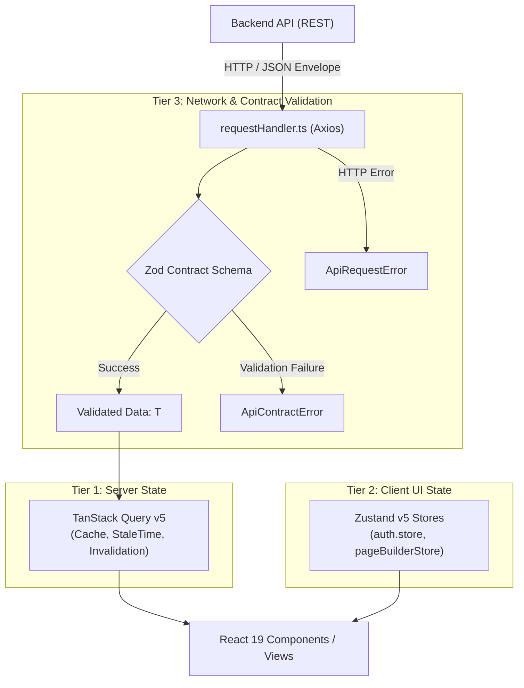

# ADR-0003: Client-Side State Architecture & Runtime Contract Validation

## Status

**Accepted** (Date: 2026-09-20)

## Context

In modern decoupled web architectures, client applications frequently suffer from two common categories of instability:

1. **State Duplication & Stale Caches**: Storing server data (collections, pages, users) in monolithic client stores (e.g., Redux or global Zustand) leads to synchronization bugs, manual refetching logic, and memory leaks.
2. **Contract Drift & Silent Crashes**: TypeScript only provides compile-time guarantees. If a backend API changes a field name, omits a nested property, or returns an unhandled error structure, client SPAs often crash silently at runtime with errors like `Cannot read properties of undefined` or `Cannot use 'in' operator to search for 'field' in undefined`.

We required an architectural pattern in `apps/cms-ui` that enforces:

- Strict separation between **server state** (data owned by the backend) and **client UI state** (ephemeral interactions, session tokens, drawer states).
- **Runtime validation** of all inbound API responses against typed Zod contracts before the data reaches application components.
- Automatic idempotency and resilient retry policies on network failures.

---

## Decision

We adopted a three-tier architecture governing client state, network communication, and contract enforcement:



### 1. Tier 1: Server State Management ([TanStack Query v5](https://tanstack.com/query/latest))

- **Ownership**: All remote entities (pages, collections, schemas, audit logs, user lists) are managed strictly through TanStack Query.
- **Caching Defaults**: Configured with a default `staleTime` of 5 minutes and single retry policy.
- **Optimistic Updates**: Mutating hooks (such as page saving and publishing in [CollectionEntriesPage.tsx](file:///home/sobhan-sahoo/code/agentic-headless-cms/apps/cms-ui/src/features/collections/pages/CollectionEntriesPage.tsx)) apply immediate optimistic updates to the query cache with automatic rollback if the API request fails.

### 2. Tier 2: Ephemeral Client State Management ([Zustand v5](https://zustand-demo.pmnd.rs/))

- **Ownership**: Strictly limited to local, non-persisted UI interactions and session lifecycle:
  - [auth.store.ts](file:///home/sobhan-sahoo/code/agentic-headless-cms/apps/cms-ui/src/features/auth/store/auth.store.ts): Session status (`idle`, `loading`, `authenticated`, `unauthenticated`, `mfa_challenge_required`), current user profile, and active MFA challenge token.
  - `pageBuilderStore.ts`: Canvas active device mode (`desktop`, `tablet`, `mobile`), selected component block ID, and unsaved changes dirty flag.

### 3. Tier 3: Centralized Network Handler & Runtime Contracts ([requestHandler.ts](file:///home/sobhan-sahoo/code/agentic-headless-cms/apps/cms-ui/src/api/requestHandler.ts))

- **Standard Envelope**: All API endpoints conform to the unified envelope:
  ```typescript
  export interface ApiResponse<T> {
    data: T;
    message?: string;
    success: boolean;
  }
  ```
- **Runtime Validation**: When an endpoint specifies a Zod schema, `validateResponse` parses `response.data.data`:
  ```typescript
  export function validateResponse<T>(
    data: unknown,
    schema: z.ZodType<T>,
    endpointLabel?: string,
  ): T {
    const result = schema.safeParse(data);
    if (!result.success) {
      console.warn(
        `[API Contract Error] Validation failed for [${endpointLabel}]:`,
        result.error.issues,
      );
      throw new ApiContractError(result.error.issues, endpointLabel);
    }
    return result.data;
  }
  ```
- **Idempotency & Safe Retries**: The underlying Axios client ([client.ts](file:///home/sobhan-sahoo/code/agentic-headless-cms/apps/cms-ui/src/api/client.ts)) automatically injects a unique `Idempotency-Key: uuid` header on all mutating requests (`POST`, `PUT`, `PATCH`, `DELETE`) and retries up to 2 times on transient HTTP network codes (`408`, `429`, `502`, `503`, `504`).

---

## Consequences

### Positive

- **Fault Isolation**: Contract violations are caught and localized immediately with explicit Zod field issue logs, preventing undefined variable crashes in deep UI trees.
- **Predictable Cache Lifecycle**: Components never suffer from out-of-sync or stale remote data; invalidation triggers declarative background refetches.
- **Safe Network Retries**: Transient network drops and rate limits recover gracefully without duplicate resource creation due to idempotency keys.

### Trade-offs & Mitigations

- **Schema Overhead**: Every backend entity needs a corresponding Zod contract in `src/features/*/validate/`.
  - _Mitigation_: Shared Zod contracts are imported directly from `@repo/validation` where possible, keeping client schemas lean.
- **Mocking Precision in Tests**: Tests and Playwright E2E suites must mock the `{ success: true, data: T }` envelope to pass `requestHandler` parsing.
  - _Mitigation_: Standardized test fixtures and mock generators ensure all unit and E2E suites match the production envelope seamlessly.
